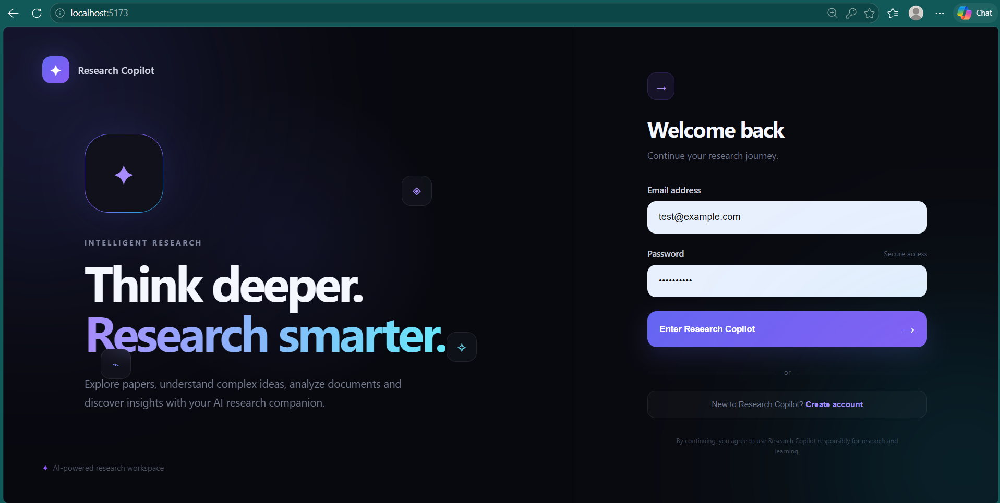
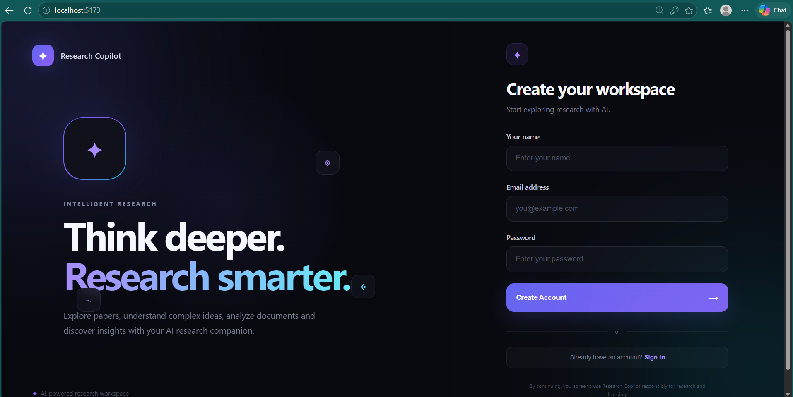
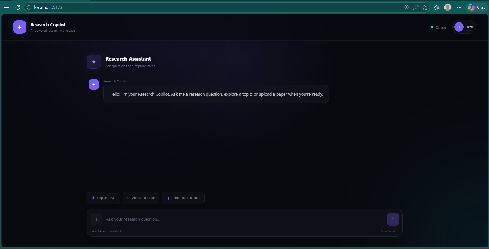
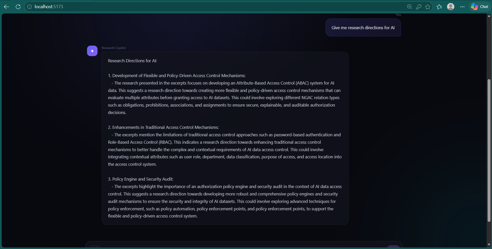
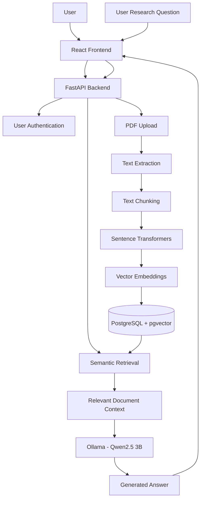

# AI Research Copilot
### An AI-Powered Research Assistant Using RAG, LLMs & Vector Search

<p align="center">
  <strong>Explore Research. Understand Faster. Discover Insights.</strong>
</p>

<p align="center">
  A full-stack AI research workspace that enables users to upload research papers, retrieve relevant information, and interact with documents through an intelligent conversational interface.
</p>

<p align="center">
  
  
  
  
  
  
</p>

---

## 📌 Overview

**AI Research Copilot** is a full-stack application designed to simplify the process of exploring and understanding academic research papers.

Traditional research workflows often require manually reading lengthy documents and searching through multiple sections to find relevant information. This project addresses that challenge by combining Large Language Models (LLMs), Retrieval-Augmented Generation (RAG), semantic search, and vector embeddings.

Users can upload PDF research papers, process their content, and ask questions through an interactive AI chat interface. The system retrieves relevant document chunks using vector similarity and uses a locally running language model to generate responses.

The application is built with a React frontend, FastAPI backend, PostgreSQL with pgvector, and Ollama for local LLM inference.

## ✨ Key Features

- **User Authentication:** Secure user registration and login with token-based authentication.
- **PDF Document Upload:** Upload research papers in PDF format.
- **Text Extraction:** Extract textual content from uploaded PDF documents.
- **Intelligent Text Chunking:** Split extracted content into smaller overlapping chunks for retrieval.
- **Vector Embeddings:** Generate 384-dimensional semantic embeddings using Sentence Transformers.
- **Vector Database:** Store document chunks and embeddings using PostgreSQL and pgvector.
- **Semantic Retrieval:** Retrieve relevant research content using vector similarity search.
- **AI-Powered Chat:** Ask natural-language questions about research documents.
- **Local LLM Integration:** Generate responses using Ollama without depending on a hosted LLM API.
- **Interactive Interface:** Modern React-based interface for document exploration and AI conversations.

## 🖥️ Application Screenshots

### 1. Login Interface



### 2. User Registration



### 3. Research Assistant Dashboard



### 4. AI-Powered Research Conversation



---

## 🏗️ System Architecture

The application follows a client-server architecture with a document-processing and retrieval pipeline.

### Architecture Workflow



### Document Processing Pipeline

1. User uploads a research paper in PDF format.
2. The backend extracts text from the PDF.
3. Extracted text is divided into overlapping chunks.
4. Sentence Transformers converts each chunk into a semantic vector embedding.
5. Embeddings and corresponding text chunks are stored in PostgreSQL using pgvector.
6. When a user submits a question, the system generates a query embedding.
7. Relevant document chunks are retrieved using vector similarity.
8. Retrieved context is provided to the local LLM.
9. The generated response is returned to the React frontend.

---

## 🛠️ Technology Stack

| Layer | Technologies |
|---|---|
| Frontend | React.js, Vite, JavaScript, CSS |
| Backend | Python, FastAPI |
| Database | PostgreSQL 17 |
| Vector Search | pgvector |
| Embedding Model | Sentence Transformers |
| Embedding Architecture | all-MiniLM-L6-v2 |
| Language Model | Qwen2.5 3B |
| Local LLM Runtime | Ollama |
| PDF Processing | pypdf |
| Authentication | JWT |
| Database Migrations | Alembic |
| Development Tools | VS Code, Git, GitHub, Docker |

## 📂 Project Structure

```text
AI-Research-Copilot/
│
├── backend/
│   ├── alembic/
│   │   └── versions/
│   │
│   ├── app/
│   │   ├── api/
│   │   │   ├── auth.py
│   │   │   ├── chat.py
│   │   │   ├── documents.py
│   │   │   └── dependencies.py
│   │   │
│   │   ├── core/
│   │   │   ├── config.py
│   │   │   ├── database.py
│   │   │   └── security.py
│   │   │
│   │   ├── models/
│   │   │   ├── user.py
│   │   │   ├── document.py
│   │   │   └── chunk.py
│   │   │
│   │   └── services/
│   │       ├── embedding_service.py
│   │       ├── llm_service.py
│   │       ├── pdf_service.py
│   │       ├── retrieval_service.py
│   │       └── text_chunker.py
│   │
│   ├── scripts/
│   ├── alembic.ini
│   └── test_text_chunker.py
│
├── frontend/
│   ├── public/
│   ├── src/
│   │   ├── assets/
│   │   ├── pages/
│   │   ├── services/
│   │   ├── App.jsx
│   │   ├── App.css
│   │   └── main.jsx
│   │
│   ├── package.json
│   └── vite.config.js
│
├── docs/
│   └── screenshots/
│
├── .gitignore
└── README.md
```

---

## ⚙️ Installation and Setup

### Prerequisites

Install the following tools before running the application:

- Python 3.12
- Node.js and npm
- PostgreSQL 17
- Docker Desktop
- Ollama
- Git

### 1. Clone the Repository

```bash
git clone https://github.com/DevKatti7560/AI-Research-Copilot.git
cd AI-Research-Copilot
```

### 2. Backend Setup

Navigate to the backend directory:

```powershell
cd backend
```

Create and activate a virtual environment:

```powershell
python -m venv venv
.\venv\Scripts\Activate.ps1
```

Install the backend dependencies:

```powershell
pip install -r requirements.txt
```

Configure your environment variables in `backend/.env`. Set the database connection and other configuration values required by the application.

**Never commit your `.env` file or actual credentials.**

### 3. Database Setup

Configure PostgreSQL and enable the pgvector extension in your database:

```sql
CREATE EXTENSION IF NOT EXISTS vector;
```

Apply database migrations:

```powershell
alembic upgrade head
```

Ensure the database connection matches the `DATABASE_URL` configuration used by the backend.

### 4. Configure Ollama

Install Ollama and download the Qwen2.5 3B model:

```powershell
ollama pull qwen2.5:3b
```

Verify that the model is available:

```powershell
ollama list
```

Make sure the Ollama service is running before using AI chat.

### 5. Start the Backend Server

From the backend directory:

```powershell
python -m uvicorn app.main:app --reload
```

Backend URL:

`http://127.0.0.1:8000`

Interactive API documentation:

`http://127.0.0.1:8000/docs`

### 6. Frontend Setup

Open another terminal and navigate to the frontend directory:

```powershell
cd frontend
```

Install dependencies:

```powershell
npm install
```

Start the React development server:

```powershell
npm run dev
```

Frontend URL:

`http://localhost:5173`

---

## 🔬 Technical Implementation

### Semantic Embeddings

The project uses:

`sentence-transformers/all-MiniLM-L6-v2`

The model converts document chunks and user queries into 384-dimensional vector representations.

### Vector Storage and Retrieval

PostgreSQL with pgvector stores the embeddings alongside their corresponding document chunks.

When a user asks a question, the system generates a query embedding and compares it with stored document embeddings to retrieve semantically relevant content.

### Retrieval-Augmented Generation

The RAG workflow combines retrieved document context with an LLM to generate answers grounded in available research material.

### Local Language Model

The application integrates Ollama with Qwen2.5 3B to support locally hosted language model inference.

---

## 🚀 Future Enhancements

- Document-specific retrieval and filtering.
- Improved retrieval ranking and contextual relevance.
- Support for multiple research document formats.
- Research paper summarization and comparison.
- Conversation history and saved research sessions.
- Source citations with page-level references.
- Advanced document analytics and knowledge extraction.
- Improved evaluation of RAG accuracy and answer faithfulness.
- Deployment using Docker and cloud infrastructure.

## 🔐 Security Considerations

- Authentication is implemented using JWT-based access tokens.
- User ownership checks are applied to document operations.
- Environment variables are used for sensitive configuration.
- Uploaded research documents and database backups should remain excluded from public repositories.
- AI-generated answers should be verified against their original research sources.

## 👨‍💻 Developer

**Devaraja Katti**

B.E. Artificial Intelligence and Machine Learning

GitHub: [@DevKatti7560](https://github.com/DevKatti7560)

## 📌 Repository

**AI Research Copilot**

[View Project on GitHub](https://github.com/DevKatti7560/AI-Research-Copilot)

---

<p align="center">
  <strong>AI Research Copilot — Making Research Exploration Smarter with AI.</strong>
</p>
